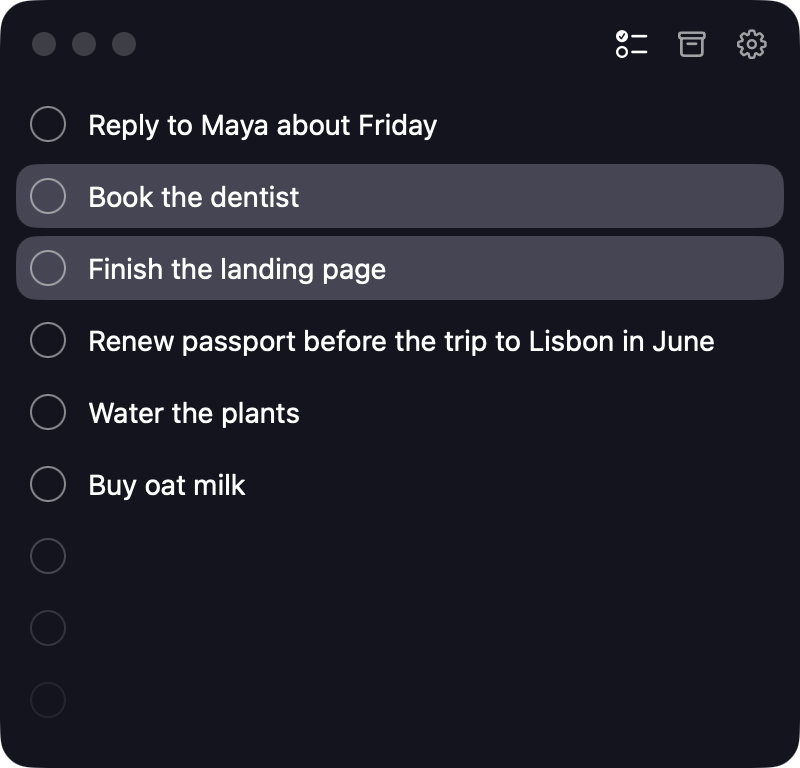

# Perch

A tiny floating todo list for the Mac. Perch keeps today's todos in a small panel that floats above your work. Type a todo, press Return, get back to it.

<p align="center"></p>

**[Download Perch](https://github.com/Joker666/Perch/releases/latest/download/Perch.dmg)** · [Website](https://rafihasan.com/Perch/) · Requires macOS 26 on Apple silicon

## Features

- **Keyboard first.** Return adds a todo below, arrows move between rows, Shift selects more, ⌘↩ completes, ⌘⌫ deletes, ⌘Z undoes anything.
- **Fits itself.** The panel grows and shrinks with the list, and springs back when you resize it too far.
- **Drag to reorder**, or press ⌥⌘↑ and ⌥⌘↓.
- **Global shortcut.** ⌃⌥Space shows the panel from any app with a new todo ready to type. Pick your own in Settings > Shortcuts.
- **Archive.** Completed todos move there, newest first. Click the check to bring one back.
- **Yours to tune.** Eight themes, one theme or one each for macOS Light and Dark, four fonts, font size, corner radius, eight app icons, and clicks when you add or complete a todo, which you can turn off.
- **Private.** Todos stay on your Mac in a local database. No account, no server, no tracking.
- **Works with agents.** The `perch` command and an MCP server let Claude Code and scripts list, add, and complete todos in the running app. Edit > Undo takes back what an agent did.
- **Updates itself** with [Sparkle](https://sparkle-project.org).

## Agents

Claude Code, Claude Desktop, and scripts can read and change your todos in the running app. Each change shows in the panel at once, and Edit > Undo takes it back. Delete commands only report what they would do until you add `--yes`. The commands are in [docs/AGENT-COMMANDS.md](docs/AGENT-COMMANDS.md).

The `perch` command is the app itself. `build.sh` links it for you. After a dmg install, link it once (`~/.local/bin` must be on your `PATH`):

```bash
mkdir -p ~/.local/bin
ln -sf /Applications/Perch.app/Contents/MacOS/Perch ~/.local/bin/perch
perch todos list
```

The MCP server, for Claude Code and other MCP clients:

```bash
claude mcp add --scope user perch -- /Applications/Perch.app/Contents/MacOS/Perch mcp
```

## Build from source

You need macOS 26 and Xcode 26 or later. There is no Xcode project: Perch is a Swift package.

```bash
./build.sh --open        # build, install to /Applications/Perch.app, and open it
swift test --scratch-path ~/Library/Developer/Perch/test-build
tools/selftest.sh        # the app's real functions on a test database
tools/snap.sh            # screenshots of every panel state and Settings tab
```

`ARCHITECTURE.md` describes the targets, layers, and rules of the code. `CLAUDE.md` has the build steps and design rules. `docs/` has the brief, the user stories, the glossary, and the agent commands.

## Releases

Push a version tag and the [Release workflow](.github/workflows/release.yml) builds `Perch.dmg`, notarizes it, signs it for Sparkle, publishes a GitHub release, and points `site/appcast.xml` at it:

```bash
git tag v1.0.0 && git push origin v1.0.0
```

The workflow needs these repository secrets:

| Secret | What it is |
| --- | --- |
| `SPARKLE_PRIVATE_KEY` | Required. The text from `generate_keys --account perch -x key.txt` (Sparkle's `bin/` folder) |
| `MACOS_CERTIFICATE_P12` | Base64 of your Developer ID Application certificate, exported as .p12 |
| `MACOS_CERTIFICATE_PASSWORD` | The password of that .p12. Leave it out when the .p12 has no password |
| `DEVELOPER_ID` | `Developer ID Application: Your Name (TEAMID)` |
| `APPLE_API_KEY_P8` | Base64 of an App Store Connect API key (.p8), for notarization |
| `APPLE_API_KEY_ID` | That key's id |
| `APPLE_API_ISSUER_ID` | That key's issuer id |

Without the Developer ID and API key secrets, the dmg is ad hoc signed and not notarized. macOS then asks people to allow it in System Settings > Privacy & Security.

`tools/release.sh` does the same build on your Mac: `VERSION=1.0.0 tools/release.sh`.

## Website

`site/` is the website at [rafihasan.com/Perch](https://rafihasan.com/Perch/). GitHub serves it there because the account's user site has that custom domain, so `joker666.github.io/Perch` redirects to it. The app's update feed uses the HTTPS address directly: the redirect goes to plain HTTP, which macOS blocks. The [Site workflow](.github/workflows/pages.yml) publishes it with GitHub Pages when `site/` changes on `main`, and after every release.

## Credits

Perch is inspired by [FloatyDo](https://floatydo.com) by Raffi Chilingaryan and Emirhan. Perch is an independent project with its own code, name, and icons, and is not affiliated with FloatyDo. If you like the idea, try theirs too.

## License

[MIT](LICENSE)
